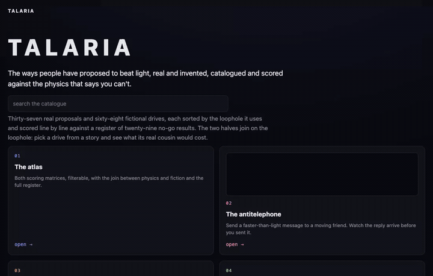

# TALARIA

*The ways people have proposed to beat light, real and invented, catalogued, graded and scored against the physics that says you can't.*



## Why TALARIA

The talaria were the winged sandals of Hermes, the oldest faster-than-anything device in Western storytelling. Nobody in the myths asks how they work. That is the interesting part: three thousand years later we still want the sandals, and physics still hasn't decided whether they are impossible or merely very expensive. This project keeps both halves in one room. The real proposals get the scrutiny of the actual theorems that constrain them. The fictional ones get sorted by which loophole they are quietly using, and graded on whether the story noticed the bill.

## The idea

Every faster-than-light scheme, whether it came from a physics journal or a screenplay, leans on one of a small number of loopholes. That is the spine of the catalogue:

| Loophole | What it does | Real physics | Fiction |
|---|---|---|---|
| **L1 Faster in the same space** | The ship itself outruns light | Tachyons | Lensman's inertialess drive, ludicrous speed |
| **L2 Move the space, not the ship** | Spacetime carries you; locally you never exceed c | Alcubierre, Natário, Lentz, Krasnikov tubes | Star Trek warp |
| **L3 Take a shortcut** | Connect two distant points through a tunnel or fold | Morris-Thorne wormholes | Interstellar, Stargate, the Expanse ring gates, Dune's fold-space |
| **L4 Leave the manifold** | Step into another space with different rules | Extra-dimensional proposals | Hyperspace, subspace, slipspace, the Warp |
| **L5 Send the message, not the ship** | Information beats light even if matter can't | Entanglement signalling, tunnelling, the Scharnhorst effect | The ansible |
| **L6 Not actually FTL** | Everything that gets filed here by mistake | Time dilation, the EM drive | Cryosleep, generation ships, the ship that stays still |

Against those sits the **constraint register**: every theorem, inequality and no-go result that puts a price on the loophole. Causality first, because any FTL signal in a Lorentz-invariant world is a message to your own past. Then the energy conditions, the quantum inequalities that cap how much negative energy you can borrow and for how long, the horizon that stops a warp-bubble crew steering, the bootstrap problem and semiclassical instability. And the result that a warp bubble drops out of warp with a shotgun blast of everything it swept up on the way.

Two scoring matrices come out of that:

1. **Physics matrix.** Every real proposal against every constraint: satisfies, violates, dodges or silent. Plus the bill: what each one needs that we do not have.
2. **Fiction matrix.** Every notable invented drive by loophole, notability and coherence: does the story engage with the physics, follow its own rules, or wave its hands? And what does it do about the time-travel implication?

The two matrices join on the loophole column. That join is the point of the project: it shows which fictional drives have a real cousin, and what that cousin costs.

## Layout

```
constraints/     the constraint register: one page per no-go result, with citations
theories/        one dossier per proposal; physics/ and fiction/ from separate templates
lineage/         who begat whom: Alcubierre was answering Star Trek, Thorne was answering Sagan
matrix/          the two scoring matrices, generated from the dossiers
web/             the interactive site: atlas, diagrams and runnable demos
tools/           health checks, index and matrix builders
```

Start at [GRADING.md](GRADING.md) for the vocabulary, then [constraints/REGISTER.md](constraints/REGISTER.md), then the [theory catalogue](theories/CATALOGUE.md).

## Editorial stance

Neutral scoring, with the consensus stated as it stands. Every real proposal is stated in its strongest form before it is scored, and every score cites the theorem it comes from. Fiction is never marked down for being fiction; it is graded on what it does with the physics it chose to invoke. Fringe and refuted proposals are included because the shape of what has been tried is part of the map.

## The site

`web/` is a static site: a hub, the atlas (both matrices, the join, the register and the lineage list), every page of the catalogue rendered from its markdown, and six demos.

| Demo | What it shows |
|---|---|
| The antitelephone | Send a faster-than-light message to a moving friend and watch the reply land before you sent it |
| The Alcubierre bubble | The shape function, the expansion and contraction, the negative-energy shells and the bill in kilograms |
| The wormhole | A throat you can walk through, its tidal limits, and what one round trip with a mouth does to it |
| Pick a drive, pick a frame | Any of the sixty-eight fictional drives, any observer, and whether the round trip lands before departure |
| The honest rocket | Ship years against home years to the nearby stars at one g, and the fuel bill |
| No signalling | Entangled pairs, any measurement you like, and nothing gets through |

Shared parts are vendored from STOA (`web/vendor/stoa/`), the palette is minted in OKLCH and validated (`web/palette.js` carries the provenance), and the only external asset is KaTeX from a CDN for the maths on the rendered pages.

```
python3 tools/build_web.py                       # render pages and data from the catalogue
python3 -m http.server 8191 --directory web      # serve
```

Then open http://localhost:8191/. Tool order after any content change: `bite.py`, `backlink.py`, `build_matrix.py`, `wiki.py`, `check_prose.py`, `build_web.py`.

## Status

Research phase, M0 complete. See [ROADMAP.md](ROADMAP.md).

*Any quotes used in this project are real, sourced attributions. No invented quotes.*
